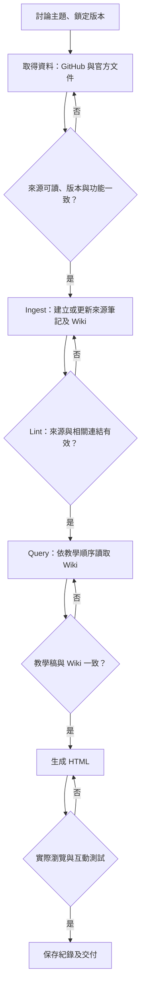

# Loop / Graph 設計

以 AI 人機協作方式執行；不是宣稱有部署自動 LangGraph 或 LLM API。LLM 在對話中實際讀取並整合資料，Python 負責可重複的查詢、編譯和驗證。更新時由維護者依 AGENTS.md 作業。

| 節點 | 重複條件 | 原因 |
|---|---|---|
| 取得資料 → 來源檢查 | 網頁取得失敗、版本/功能資料不一致 | 不把無法核實的內容攝取 |
| Ingest → Lint | 連結失效、缺少來源或出現矛盾 | 保護整個知識庫品質 |
| Query → 教學稿檢查 | 未對應 Wiki、順序不適合或忽略限制 | 避免生成時扭曲資訊 |
| HTML → 瀏覽測試 | 導覽、互動、排版或連結有問題 | 不把不可用網頁交給老師 |

本次實際改善：原構想等 Wiki 建完才確認版本，讀取 GitHub 後發現原本規劃的新功能和固定版本不符，README 也有歷史狀態；已在 Ingest 前插入版本、來源與功能檢查。網頁來源取得失敗時剔除該來源，不將其列入攝取數。見 logs/validation.md 與 reflection.md。
